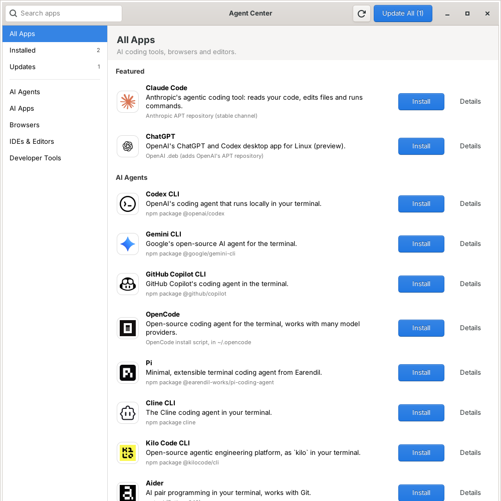

<div align="center">


# Agent Center

**A small app center for Debian that cleanly installs, updates and removes AI coding tools, browsers and editors.**

One ~1 MB binary · GTK 3 window and CLI · no system service · every recipe is a readable script

[](https://github.com/alexandreravelli/agent-center/actions/workflows/ci.yml)
[](https://github.com/alexandreravelli/agent-center/releases/latest)
[](LICENSE)
[](https://www.rust-lang.org)
[](https://www.debian.org)

[Install](#-install) · [Catalog](#-catalog) · [Command line](#%EF%B8%8F-command-line) · [How it works](#-how-it-works) · [Changelog](CHANGELOG.md)



</div>

---

## ✨ Features

|  |  |
| --- | --- |
| 🧰 **One place for your tools** | Claude Code, ChatGPT, Codex, OpenCode, DeepSeek Harness, Pi, Cline, Kilo Code, Aider, Goose, OpenClaw, Hermes, T3 Code, Cursor, Zed, Firefox, Zen, Vivaldi and more, sorted into categories. Claude Code and ChatGPT are featured at the top. |
| ✅ **The vendor's own method** | Each app is installed exactly the way its vendor documents it: their signed APT repository, their npm package, their `.deb`, or their install script. |
| 🎨 **Real logos** | Every app shows its logo, almost always the SVG file its vendor publishes ([sources](logos/SOURCES.md)). |
| 🔍 **Nothing hidden** | The *Details* button shows every command Agent Center will run for an app, before it runs. |
| 🧹 **Clean removal** | Removing an app also removes the APT repository and signing key it added. Tick *Also delete its settings and data* to wipe `~/.claude`, `~/.codex` and friends too. |
| 🚀 **Open in one click** | Installed apps get an *Open* button: desktop apps start, and command-line agents open in a terminal. |
| 🔄 **Updates in one click** | Agent Center compares installed versions with npm, PyPI, GitHub releases and the vendors' APT indexes. *Update All* does the rest. |
| 🔔 **Update notifications** | Once a day, a desktop notification tells you when an installed app has a new version. Click it to open the Updates page. |
| 📬 **Updates itself with APT** | The package adds Agent Center's signed APT repository, so `apt upgrade` brings new versions of Agent Center too. |
| 🪶 **Featherweight** | No system service: the window runs only while it is open, and the notifier wakes up once a day. Perfect for VMs and remote desktops. |
| 🔐 **Asks for your password only when needed** | System-wide apps go through `sudo` (with a small password window) or `pkexec`; apps that live in your home directory never ask. |
| 📝 **Extend it with a text file** | The catalog is plain TOML. Drop a file in `/etc/agent-center/catalog.d/` to add your own apps. |

## 📦 Install

### Debian 13 package (recommended)

Install the `.deb` from the [latest release](https://github.com/alexandreravelli/agent-center/releases/latest):

```sh
cd /tmp
wget https://github.com/alexandreravelli/agent-center/releases/latest/download/agent-center_amd64.deb
sudo apt install ./agent-center_amd64.deb
```

Open **Agent Center** from the applications menu (System), or run `agent-center`.

The package adds Agent Center's APT repository (`/etc/apt/sources.list.d/agent-center.sources`), so new versions arrive with `sudo apt update && sudo apt upgrade`. To stop that, add the line `Enabled: no` to the file. Removing the package removes the repository too.

The update notifier starts at login. To turn it off, untick **Agent Center Updates** in *Settings > Session and Startup > Application Autostart*.

Your user needs to be in the `sudo` group to install system-wide apps (`sudo adduser $USER sudo`, then log in again).

### From source

Agent Center needs Rust 1.92 or newer (Debian 13 ships 1.85), so install the current toolchain with rustup:

```sh
sudo apt install -y build-essential curl git libgtk-3-dev
curl --proto '=https' --tlsv1.2 -sSf https://sh.rustup.rs | sh -s -- -y --profile minimal
. "$HOME/.cargo/env"
git clone https://github.com/alexandreravelli/agent-center
cd agent-center
make
sudo make install
```

`cargo build --release --no-default-features` builds the command line alone, without GTK.

## 🗂 Catalog

| Category | Apps | Installed with |
| --- | --- | --- |
| **AI Agents** | Claude Code | Anthropic APT repository (stable channel) |
| | Codex CLI, Gemini CLI, GitHub Copilot CLI, Pi, Cline CLI, Kilo Code CLI, OpenClaw, DeepSeek Harness | npm (global, in the Node.js prefix) |
| | OpenCode, Goose CLI, Hermes Agent, Cursor CLI | the vendor's install script, in your home directory |
| | Aider | `uv tool` with Python 3.12 |
| **AI Apps** | Claude Desktop | Anthropic APT repository |
| | ChatGPT (with Codex) | OpenAI `.deb`, which adds OpenAI's repository |
| | T3 Code, OpenCode Desktop, OpenClaw Desktop, Goose Desktop | the vendor's `.deb` from its releases |
| | Hermes Desktop | built locally with `hermes desktop` |
| **Browsers** | Firefox, Helium, Brave | the vendor's APT repository |
| | LibreWolf | LibreWolf's APT repository, added with extrepo |
| | Google Chrome, Vivaldi | the vendor's `.deb`, which adds its APT repository |
| | Zen Browser | Zen's install script, in your home directory |
| | Chromium | Debian |
| **IDEs & Editors** | VSCodium, Visual Studio Code, Windsurf | the vendor's APT repository |
| | Cursor | the `.deb` listed on cursor.com/downloads |
| | Zed | Zed's install script, in your home directory |
| | Antigravity | Google's Linux tarball, in your home directory |
| **Developer Tools** | Node.js LTS | nodejs.org tarball in `/usr/local`, checksum verified |
| | uv, GitHub CLI | Astral's install script / GitHub's APT repository |

npm-based agents need Node.js: Agent Center installs it first when it is missing.

## ⌨️ Command line

```text
agent-center                          open the window
agent-center --updates                open the window on the Updates page
agent-center list [--installed]       list the apps
agent-center list --updates           installed apps with a newer version
agent-center info claude-code         show an app and the exact scripts Agent Center runs
agent-center install codex pi         install apps (and what they need)
agent-center update                   update every app that has an update
agent-center remove --purge codex     remove an app and delete its settings and data
agent-center notify --now             check for updates now and show a notification
```

Handy for provisioning a fresh VM:

```sh
agent-center install nodejs claude-code codex opencode firefox vscodium
```

## 🔧 How it works

- **Catalog.** Apps are described in TOML files read from `/usr/share/agent-center/catalog` (shipped), `/etc/agent-center/catalog.d` (yours, system-wide) and `~/.config/agent-center/catalog.d` (yours, home-directory apps only). A later file with the same `id` replaces an app.
- **Recipes.** Each app has `install`, `update`, `remove` and `version` shell snippets that use a few helpers (`apt_key`, `apt_install`, `npm_global`, `deb_from_url`...). `agent-center info <app>` prints them along with the helpers.
- **Privileges.** Apps with `scope = "system"` run their scripts as root. Agent Center runs `sudo agent-center run-system <app>:<action>`, which only reads root-owned catalog files, so a file in your home directory can never run as root. Apps with `scope = "user"` run as you.
- **Logos.** Each app shows `/usr/share/agent-center/logos/<id>.svg`, or the file its `logo` field names (a name in that directory or an absolute path to an SVG or PNG). Without one, Agent Center uses the icon theme, then a lettered badge.
- **Open.** The Open button starts the first desktop entry found among the app's `desktop` IDs (`firefox.desktop`), like the applications menu does. For command-line tools it runs the app's `command` (`claude`) in a terminal (`x-terminal-emulator`) through your login shell, so the PATH set by install scripts applies.
- **Notifications.** `agent-center notify` starts with your session (`/etc/xdg/autostart/agent-center-notify.desktop`). Three minutes after login, then once a day, it checks the installed apps and sends a notification for versions it has not announced yet (remembered in `~/.local/state/agent-center/announced`).
- **APT repository.** Each release is also a flat APT repository: the `.deb`, `Packages` and an `InRelease` index signed with the key in [`data/agent-center-archive-keyring.gpg`](data/agent-center-archive-keyring.gpg) (fingerprint `E7C8 223E 601C DBE9 FA24 09D3 B48F F8E3 56E8 E1B8`). APT reads it from `https://github.com/alexandreravelli/agent-center/releases/latest/download/`. The release workflow signs with the `APT_SIGNING_KEY` secret and publishes the release once every file is uploaded.
- **Versions.** The installed version comes from the app itself (`dpkg`, the npm package, or `--version`). The latest version comes from npm, PyPI, GitHub releases or the vendor's APT index. Agent Center checks the latest versions of installed apps only, when the window opens or when you press the refresh button.

### Add your own app

```toml
# /etc/agent-center/catalog.d/my-tools.toml
[[app]]
id = "crush"
name = "Crush"
category = "agents"
summary = "Charm's glamorous AI coding agent."
homepage = "https://github.com/charmbracelet/crush"
logo = "/etc/agent-center/logos/crush.svg"   # optional
scope = "system"
method = "Charm APT repository"
version = "deb_version crush"
latest = "github:charmbracelet/crush"
install = '''
apt_key https://repo.charm.sh/apt/gpg.key /etc/apt/keyrings/charm.gpg
echo "deb [signed-by=/etc/apt/keyrings/charm.gpg] https://repo.charm.sh/apt/ * *" > /etc/apt/sources.list.d/charm.list
apt_install crush
'''
update = "apt_upgrade crush"
remove = '''
apt_purge crush
drop /etc/apt/sources.list.d/charm.list /etc/apt/keyrings/charm.gpg
'''
purge = ["~/.config/crush", "~/.local/share/crush"]
```

## 📄 License

[MIT](LICENSE) for Agent Center's code. App names, logos and trademarks belong to their owners: the logos in [`logos/`](logos) come from each vendor's own sources, unchanged apart from editor metadata, or for Cursor, Windsurf, Vivaldi and Antigravity from the Simple Icons (CC0) and Lobe Icons (MIT) sets, as listed in [logos/SOURCES.md](logos/SOURCES.md), and are only used to identify the apps. Agent Center is not affiliated with any of these vendors; it only runs their documented install steps.
